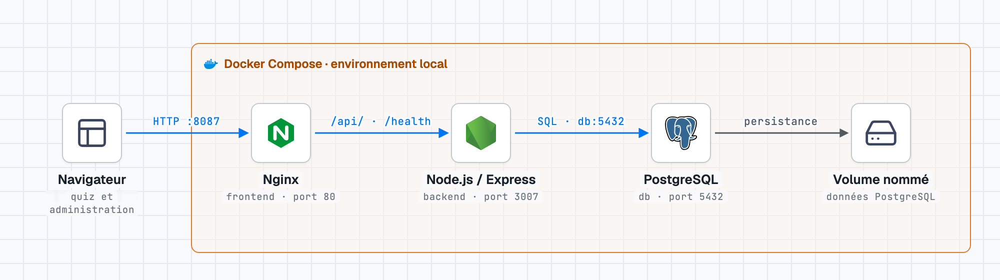

# Quiz App — Architecture locale (J1)

## Services et réseau

| Service Compose | Rôle | Accès prévu |
| --- | --- | --- |
| `frontend` | Nginx sert les pages compilées par Vite et relaie `/api/` et `/health` vers Express. | `http://localhost:8087`, port 80 dans le conteneur |
| `backend` | Express gère les inscriptions, les résultats et l’administration. | `backend:3007` sur le réseau Compose |
| `db` | PostgreSQL stocke les utilisateurs, les résultats et les réponses. | `db:5432` sur le réseau Compose |

Seul le port de Nginx est publié. Le frontend envoie ses requêtes à `/api/` sur la même origine. Les questionnaires sont définis dans les fichiers `questions_*.js` et intégrés au build Vite.

## Configuration et données

- PostgreSQL reçoit `POSTGRES_USER`, `POSTGRES_PASSWORD` et `POSTGRES_DB`. Le backend reçoit `DATABASE_URL`, construite avec ces valeurs et l’hôte `db`. Le fichier `database/init.sql` initialise le schéma au premier démarrage sur un volume vide.
- Un volume nommé conserve les données lors de la recréation du conteneur PostgreSQL. Le test de persistance garde ce volume.
- Le backend reçoit `ADMIN_USERNAME`, `ADMIN_PASSWORD` et `JWT_SECRET`. Le dépôt contient un `.env.example` avec des valeurs fictives. Les valeurs locales restent dans le `.env` ignoré par Git.
- Le code actuel initialise Resend au démarrage et exige une valeur pour `RESEND_API_KEY`, même sans envoi réel. `FROM_EMAIL` définit l’expéditeur quand le service d’email est configuré.

## Vérification prévue

1. Ouvrir le quiz et vérifier `GET /health` via Nginx. Cette route vérifie que l’API répond, sans interroger PostgreSQL.
2. Créer un utilisateur, terminer un quiz et retrouver son résultat via `/gestion-quiz`.
3. Recréer les conteneurs en gardant le volume PostgreSQL, puis retrouver le même résultat.
